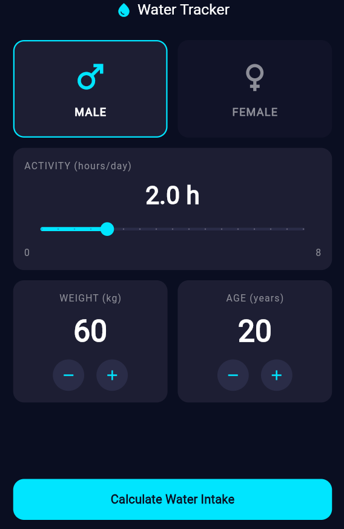
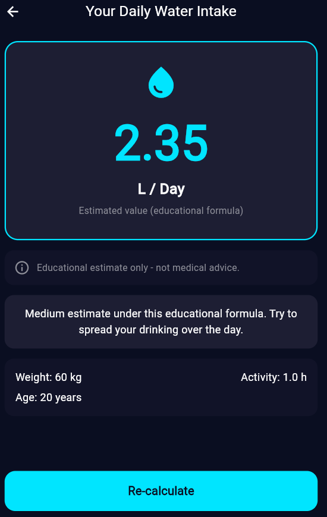

# Daily Water & Hydration Tracker App

A Flutter app (Dark UI) that estimates the daily water intake from weight and
activity hours, and shows the result on a separate screen.

> Educational estimate only - not medical advice.

## Screenshots
| Input Screen | Result Screen |
|---|---|
|  |  |

## How to run
```bash
flutter pub get
flutter run
```

## Formula
```
baseMl     = weightKg * 35
activityMl = activityHours * 250
totalMl    = baseMl + activityMl
litres     = totalMl / 1000
```
Example: 70 kg, 2 h -> 2450 + 500 = 2950 ml = **2.95 L / Day**.
Gender and age do not affect the result (no justified formula); they are
shown only as information.

## Validation
- Weight: 30-200 kg, Age: 10-100, Activity: 0-8 h
- Gender must be selected before calculating (SnackBar otherwise)

## Project structure
```
lib/
├── main.dart
├── screens/   input_screen.dart, result_screen.dart
├── widgets/   gender_card.dart, counter_card.dart, bottom_button.dart
└── utils/     water_calculator.dart, constants.dart
```

## Widgets used
MaterialApp, ThemeData, Scaffold, AppBar, SafeArea, SingleChildScrollView,
Container, Column, Row, Expanded, Flexible, Padding, SizedBox, Text, Icon,
Slider, SliderTheme, GestureDetector, ElevatedButton, RawMaterialButton,
Center, Navigator (push / pop), StatelessWidget, StatefulWidget (setState).
